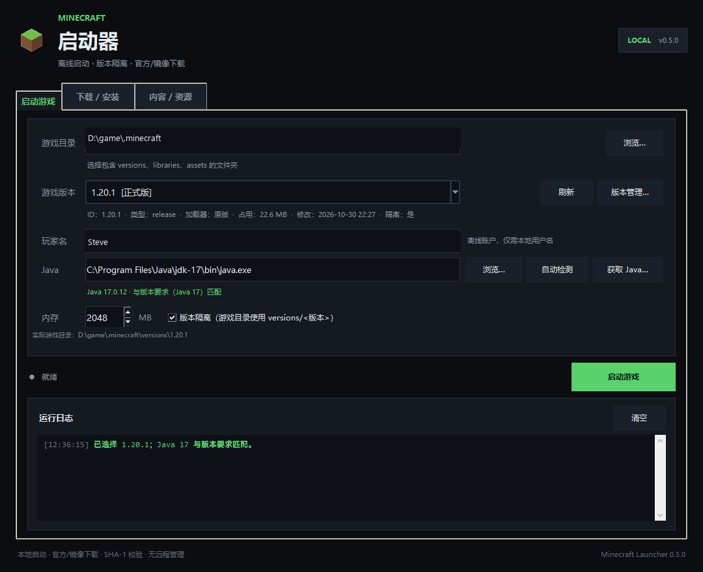
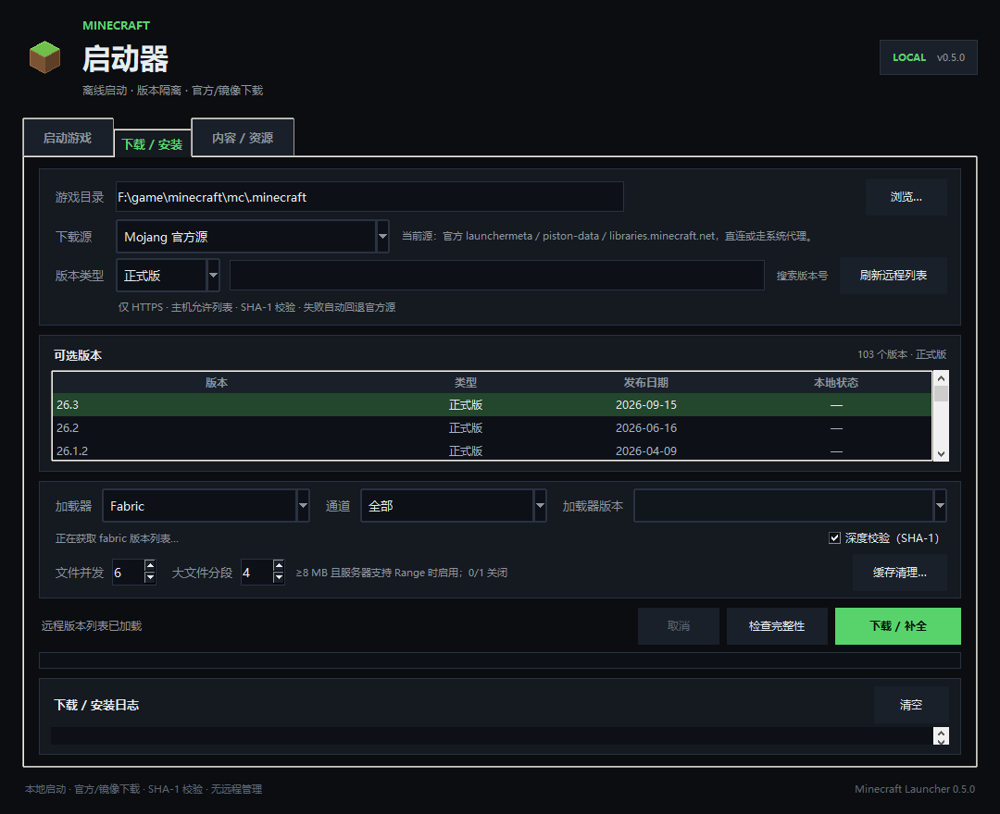
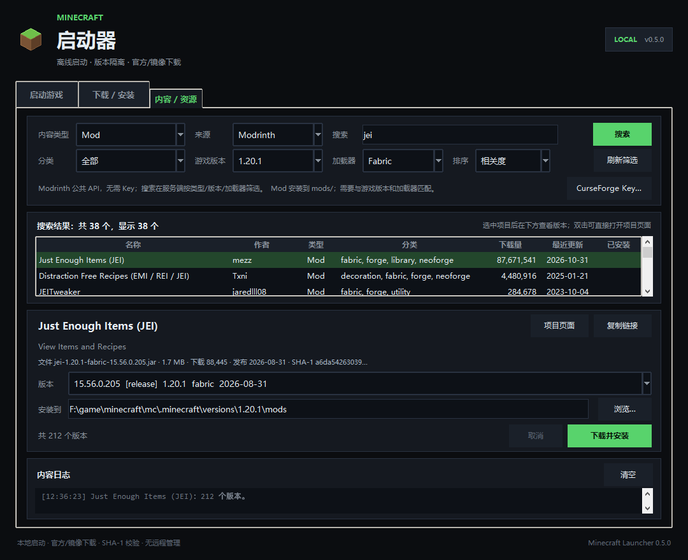
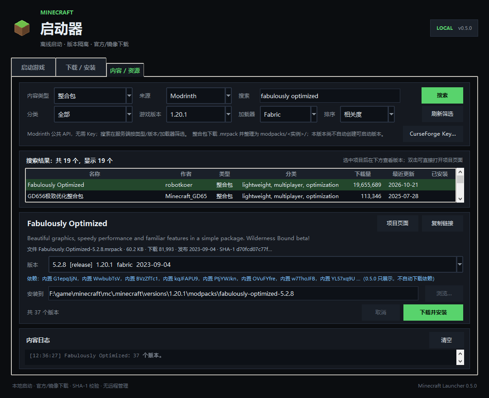
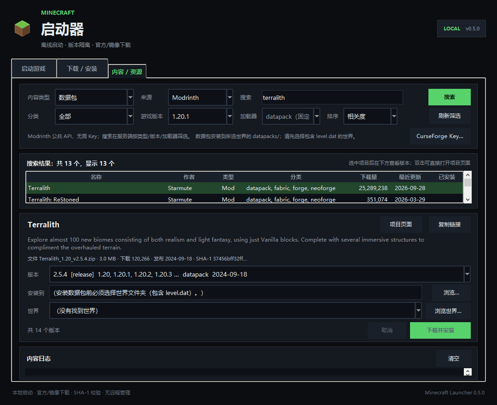
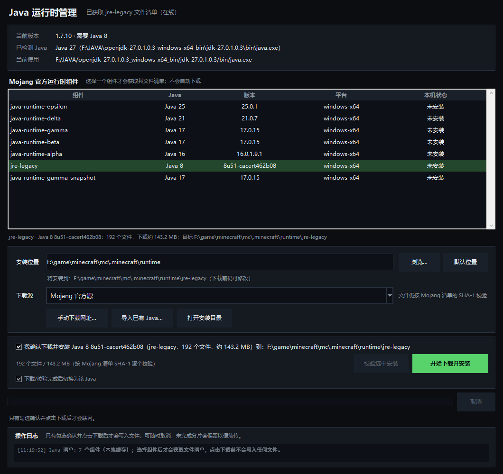
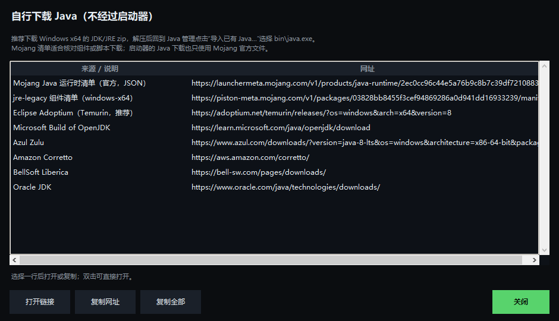

# Minecraft 启动器（本地 + 下载器 + 内容中心）

一个用 Python + Tkinter 编写的 Windows Minecraft 启动器。**0.7.0 候选**在 0.6.3 基础上加入 **微软账户登录**（设备代码流程）与 **CI**；0.6.3 的加载器默认隔离仍然有效：

- **微软账户登录（0.7.0 候选，待实网验收）**：在“启动游戏”页点“微软登录…”，用浏览器完成 Microsoft 设备代码验证；登录后自动使用正版档案名/UUID/访问令牌，可进入开启正版验证的服务器。刷新令牌使用 Windows DPAPI 加密保存，不写入 `config.json`/日志；随时可“退出登录”回到离线模式。
- **Azure 应用需要 Mojang allowlist 批准**：启动器不内置官方 client ID；首次登录需填入你自己在 Microsoft Entra ID 注册的 Application (client) ID（公共客户端 + 允许 device code flow），并提交 Minecraft Java Edition Game Service API 审核。未获批准的 client ID 会在最后一步返回 `403 Invalid app registration`（账号有 Java 版也会被拒绝）。
- **CI**：`.github/workflows/ci.yml` 在 Windows 上跑 Python 3.11/3.13 单元测试、`compileall` 和 PyInstaller onedir 构建；本地可用 `ci.ps1` 复现测试步骤。

0.6.3 的修复与能力保留：

- **加载器版本默认隔离**：NeoForge、Quilt、Forge、Fabric 等带 `inheritsFrom` 的版本默认使用 `versions/<版本>/` 作为游戏目录，Mod、配置、存档不再读取共享 `.minecraft/mods`；仍可手动取消“版本隔离”恢复共享布局。
- **NeoForge 元数据/依赖允许 BMCLAPI**：即使下载源选“Mojang 官方源”，加载器安装与元数据客户端也允许 BMCLAPI Maven 镜像；解决 `bmclapi2.bangbang93.com` 被主机允许列表拒绝、官方 `maven.neoforged.net` 又超时的问题。
- **内容页游戏版本默认值**：0.6.1 修复打开“内容 / 资源”页时把所选实例 ID（如 `fabulously-optimized-14.1.1`）当成游戏版本的问题；现在沿 `inheritsFrom` 找到真正的 Minecraft 版本（例如 `26.2`），原版/纯加载器版本也分别显示 `1.20.1`、`26.2`。
- **NeoForge 自动安装**：兼容 1.20.1 的 legacy `net.neoforged:forge` 与 1.20.2+ 的 `net.neoforged:neoforge`；复用 Forge 式官方安装器流程，优先从 BMCLAPI Maven 镜像下载安装器和依赖；
- **Quilt 自动安装**：读取 Quilt Meta 的 loader profile，像 Fabric 一样写入版本 JSON 并下载 Maven 库；
- **多任务下载队列**：下载页“加入队列”和内容页“加入队列”把游戏/加载器安装、Mod/资源包/光影/数据包、整合包排入同一个队列；默认并发 1（可调 1–3），每个任务可暂停/继续/取消，关闭队列窗口不会停止下载；
- **共享目录文件锁**：同一游戏目录的并发任务不会同时写同一个 `.part` 文件；
- **0.5.4 能力保留**：所有下载支持分段、暂停/继续、取消清理；整合包以 `versions/<实例>/` 为游戏目录；Fabric Maven 库优先 BMCLAPI。

0.5.4 的下载控制与内容中心仍然有效：

- **所有下载都可多线程**：游戏文件、Fabric/Forge/NeoForge/Quilt 依赖、Java 运行时、Mod/资源包/光影/数据包、整合包归档与内容统一走 `HttpClient` 分段下载；文件 ≥ 8 MB 且服务器支持 `Range` 时自动分段，否则回退单流；
- **暂停/继续**：下载页、内容页、Java 管理窗口和下载队列都有暂停/继续，暂停保留 `.part`/`.part.segN`，继续时从断点恢复；
- **取消即清理**：取消会停止所有分片并删除本次下载的文件、`.part` 和分段文件；暂停不会删除，二者语义分离；
- **Fabric Maven 镜像优先**：Fabric profile 中的 `maven.fabricmc.net` 库优先尝试 BMCLAPI Maven，再回退官方；避免 `intermediary` 等文件在官方超时时长时间卡住；
- **整合包直接版本目录**：0.6.0 延续 0.5.2 布局，新安装以 `versions/<实例>/` 本身为游戏目录。

- **整合包可启动**：读取 `.mrpack` 的 `dependencies`，自动安装对应的 Minecraft + Fabric/Forge/NeoForge/Quilt，注册为 `versions/<实例>/<实例>.json`，版本目录本身就是游戏目录；
- **版本隔离**：每个整合包拥有自己的 `mods/`、`config/`、`saves/`、`options.txt`，不会污染其他版本；删除该版本即可同时删除它的整合包内容；
- **本地压缩包安装**：内容页“从压缩包安装…”和 CLI `--modpack-archive` 可直接安装本地 `.mrpack` 或包含 `modrinth.index.json` 的 ZIP；
- **安装前预览/确认**：显示 Minecraft 版本、加载器、实例目录、文件数和大小；本地压缩包同样经过 ZIP 安全校验。

0.5.0 已有的内容下载中心：

- **五类内容**：Mod、整合包、数据包、资源包、光影包；
- **搜索与筛选**：按内容类型、游戏版本、加载器、分类、来源筛选，支持相关度/下载量/关注数/最近更新排序；
- **版本选择**：每个项目列出匹配版本，默认优先 release，也可以手动改选任意版本；
- **来源选择**：默认 Modrinth（公共 API，无需 Key）；可选 CurseForge（需要用户自己的 API Key，只保存在本机）；
- **按类型安装**：Mod → `mods/`，资源包 → `resourcepacks/`，光影 → `shaderpacks/`，数据包 → 所选世界的 `datapacks/`，整合包 → 隔离版本实例；
- **安全与确认**：只允许 HTTPS 和内容源主机，下载前显示文件/大小/目标，必须确认后才写入；SHA-1 校验、路径穿越/zip-slip/符号链接/大小上限检查、取消与续传沿用下载器；
- **安装记录**：写入 `.mc-launcher-content.json`，结果表显示“已安装”；整合包写入实例内 `.mc-launcher-modpack.json`。

0.4.0 加入 **Java 运行时管理**：

- **无匹配 Java 会明确提醒**：版本提示、启动前检查都会指出缺少的 Java 版本，不会静默失败；
- **只有用户允许才下载**：Java 管理窗口必须先勾选确认、再确认一次才会联网写入文件；CLI 必须交互确认或显式 `--yes`；
- **全程可选择**：可切换 Mojang 官方/BMCLAPI 源、选择任意安装目录、选择 Java 8/16/17/21/25 组件、随时取消，并可在下载后选择是否切换；
- **可自行下载**：内置 Mojang 清单地址和 Adoptium、Microsoft、Azul、Corretto、BellSoft、Oracle 等发行版网址，支持“导入已有 Java…”；
- **可校验/补齐**：按安装记录逐个校验 SHA-1，只补全缺失/损坏文件。

0.3.0 加入：

- **版本管理**：启动页“版本管理…”显示每个版本的加载器、占用大小、修改时间、是否隔离，可删除单个版本或打开版本文件夹；删除只影响 `versions/<版本>`，不会动共享库和存档；
- **缓存清理**：按类别统计并清理元数据缓存、Forge 安装器、临时 natives 和残留 `*.part` 分片，绝不删除 `versions`/`libraries`/`assets`/存档；
- **多线程下载**：文件并发可调（默认 6），≥ 8 MB 的文件在服务器支持 `Range` 时按最多 4 段并发下载，失败或不支持时自动回退单线程，断点续传仍然可用。

0.2.x 原有的能力：

- 从 **Mojang 官方源** 或 **BMCLAPI 镜像** 下载游戏；
- **正式版 / 快照 / 远古版本** 版本选择；
- **Fabric / Forge** 加载器安装，加载器版本与游戏版本对应；
- 文件完整性检查（存在性、大小、SHA-1）和缺失/损坏文件补齐；
- 旧版 `virtual` / `map_to_resources` 资源整理；
- 下载取消、重试、断点续传与进度显示；
- 0.2.1：中断后保留可续传分片、下载进度按真实字节统计（重试/续传不重复计数）、版本 JSON 损坏自动重写、下载顺序调整为基础文件优先。
- 0.2.2：修复 Forge `inheritsFrom` 安装启动时因父版本客户端 jar 未被 `-DignoreList` 忽略而触发的 `ResolutionException`（重复包），实测 Forge 1.20.1 可进入游戏窗口。

适合本地单人、离线服务器和局域网使用。**支持离线账户与微软账户登录，不做远程管理，不提供任何监听端口或遥测。**















## 主要功能

### 启动

- 自动扫描 `versions/`，合并 `inheritsFrom` 父版本 JSON，支持 Forge、Fabric、Quilt、NeoForge 常见继承结构。
- 解析客户端 jar、libraries、natives、资源索引、log4j 配置。
- 自动检测 Java：`JAVA_HOME`、`PATH`、`.minecraft/runtime`、常见 JDK 目录。
- 根据版本 JSON 的 `javaVersion.majorVersion` 推荐 Java。
- Java 运行时管理（0.4.0）：无匹配 Java 时提示；“获取 Java…”可查看 Mojang 组件、选择安装位置和下载源、确认后下载、取消、校验/补齐、导入已有 `java.exe`，以及复制/打开自行下载的官方网址。
- 微软账户登录（0.7.0 候选）：启动页“微软登录…”使用 Microsoft 设备代码流程；登录成功后使用正版档案名、UUID 与 Minecraft 访问令牌启动，令牌到期会自动刷新；刷新令牌用 Windows DPAPI 加密保存，退出登录会删除。
- 离线回退：未登录或退出登录时仍使用本地玩家名离线启动；微软登录失败不会破坏已安装版本。
- 版本隔离：勾选后游戏目录使用 `versions/<版本>/`，自动识别 PCL、HMCL、mods、saves、options.txt 等标记；带 `inheritsFrom` 的加载器/整合包版本（NeoForge、Quilt、Forge、Fabric）默认隔离，不再读取共享 `.minecraft/mods`。
- 旧版虚拟资源：启动时使用 `assets/virtual/<索引>` 或 `resources/`，不再只给警告。
- 版本管理：详情列表（类型/加载器/占用/修改时间/隔离）、打开版本文件夹、删除版本；删除前二次确认，运行中的版本拒绝删除。
- 版本提示行直接显示占用大小、加载器、修改时间和隔离状态。

### 下载 / 安装

- **下载源**：
  - `BMCLAPI 镜像（国内加速）`：默认；元数据、客户端、库和加载器优先走镜像，失败自动回退官方源。
  - `Mojang 官方源`：直连 `piston-meta` / `piston-data` / `libraries.minecraft.net` / Forge、Fabric 官方端点。
- **版本类型**：正式版、快照、远古版本（old_beta/old_alpha）、全部。
- **搜索**：按版本号过滤；显示发布日期和本地安装状态。
- **Fabric**：加载器通道“稳定 / 最新 / 全部”，版本与所选游戏版本严格对应；通过 Fabric 官方 profile JSON 安装，不执行下载的代码。
- **Forge**：加载器通道“推荐 / 最新 / 全部”，版本来自 Forge Maven 元数据和 promotions；安装前会预取依赖并校验官方安装器 SHA-1，再运行 Forge 官方安装器。
- **NeoForge**：1.20.1 使用 `net.neoforged:forge`，1.20.2+ 使用 `net.neoforged:neoforge` 并按 Minecraft 版本推导版本前缀（1.21.1 → 21.1.x，26.3 → 26.3.0.x）；安装器与依赖优先走 BMCLAPI Maven 镜像，版本 JSON 中的 `minecraft` 会与所选版本二次核对。
- **Quilt**：加载器版本来自 Quilt Meta，profile 与 Fabric 类似；库优先走 BMCLAPI（Fabric Maven 部分），`org.quiltmc:*` 走官方 Quilt Maven。
- **原版**：直接安装客户端 jar、libraries、assets、日志配置。
- **完整性**：
  - 快速模式：检查文件是否存在、大小是否匹配；
  - 深度模式（默认）：额外校验 SHA-1；
  - 只下载缺失/损坏的文件，不重复下载完整文件；
  - 下载失败自动切换备用地址；临时网络错误会保留 `.part` 分片，重试或下次安装从断点续传；
  - 下载进度按“文件当前已落盘字节”统计，重试和续传不会重复计数；
  - 下载顺序为客户端 jar / 资源索引 / 库优先，资源对象最后。
- **版本 JSON**：缺失时写入；已存在但 JSON 损坏或 `id` 与版本不符时自动重写，其他启动器添加的字段会保留。
- **旧版资源**：安装完成后自动生成 `assets/virtual/<索引>`，需要时生成 `resources/`。
- **下载并发**：下载页可设置文件并发（1-12，默认 6）与大文件分段（0-8，默认 4）；该分段设置同时用于游戏、Java、内容与整合包下载。
- **大文件分段**：文件 ≥ 8 MB 且服务器返回 `206 Partial Content` 时按分段数并发下载；分段写入 `<文件>.part.segN`，全部完成后合并、校验大小与 SHA-1 再原子替换。服务器返回 `200`（忽略 Range）或分段失败时自动回退单线程。
- **暂停/继续**：下载页、内容页、Java 管理窗口都有“暂停/继续”；暂停会停止读取并保留 `.part` 与分段，继续时从断点恢复，暂停不会删除文件。
- **多任务下载队列**：下载页“加入队列”、内容页“加入队列”和本地整合包确认框都可把任务排入队列；队列窗口显示状态/进度/大小，可暂停、继续、取消、移除；默认并发 1，可在队列窗口调到 1–3。队列不跨启动器重启保留。
- **取消即删除**：取消会通知所有并发任务停止，并删除本次下载的完整文件、`.part` 和 `.part.segN`；与“暂停”明确区分。已经存在于操作之前且校验通过的文件不会因取消被误删。
- **缓存清理**：下载页“缓存清理…”显示各类缓存大小，可勾选清理；只清理启动器自己的缓存和残留分片。

### 内容 / 资源（0.6.0）

- **独立标签页**：“内容 / 资源”与“启动游戏”“下载 / 安装”并列，不挤占游戏下载页。
- **内容类型**：Mod、整合包、数据包、资源包、光影包。数据包使用 `project_type=mod` + `loaders:datapack` 查询，不会把普通 Mod 当成数据包。
- **来源**：
  - Modrinth：`https://api.modrinth.com/v2`，公共 API，无需 Key；搜索、分类、游戏版本、加载器都在服务端筛选，本地再做一次过滤兜底；
  - CurseForge：`https://api.curseforge.com/v1`，需要用户自己的 API Key；未配置时明确提示，不影响使用 Modrinth。作者禁止第三方分发（`downloadUrl=null`）时拒绝自动下载并给出项目页面。
- **搜索筛选**：内容类型、来源、关键词、分类、游戏版本、加载器、排序；输入防抖 350 ms，Enter 立即搜索。
- **结果与详情**：名称、作者、类型、分类、下载量、最近更新、已安装；选中后显示简介、分类、项目链接，版本下拉（版本号/通道/游戏版本/加载器/日期），依赖只展示（必需/可选/不兼容），不自动递归下载。
- **安装**：
  - Mod → `<游戏目录>/mods/<文件>`；
  - 资源包 → `<游戏目录>/resourcepacks/`；
  - 光影包 → `<游戏目录>/shaderpacks/`；
  - 数据包 → 必须选择包含 `level.dat` 的世界，安装到 `<世界>/datapacks/`；
  - 整合包 → 下载 `.mrpack` 到缓存，校验 ZIP 和 `modrinth.index.json`，自动安装声明的 Minecraft + Fabric/Forge，创建 `versions/<实例>/<实例>.json`；`mods/`、`config/`、`saves/` 直接放在 `versions/<实例>/`，并写 `.mc-launcher-modpack.json`。
- **本地压缩包**：结果区“从压缩包安装…”选择 `.mrpack` 或带 `modrinth.index.json` 的 ZIP；先读取索引并显示依赖/实例路径，确认后才安装。CLI 对应 `--modpack-archive PATH`，`--modpack-name` 可自定义实例名，`--modpack-no-launch` 只整理内容。
- **隔离与命名**：实例名默认 `<项目 slug 或整合包名>-<整合包版本>`；同一整合包重复安装会复用并修复原实例，遇到其他版本的目录则自动追加 `-2`、`-3`，不会覆盖无关版本。
- **确认与覆盖**：点击“下载并安装”或“从压缩包安装”后再弹窗确认；实例已存在时询问是否覆盖同名文件；暂停保留 `.part`，取消会删除本次文件。
- **安装记录**：普通内容写入游戏目录 `.mc-launcher-content.json`（项目/版本/文件名/SHA-1/大小/来源）；再次搜索时结果表显示“已安装”。整合包实例内写入 `.mc-launcher-modpack.json`，记录 `launchable`、版本目录、加载器和文件 SHA-1。
- **NeoForge / Quilt**：0.6.0 起两者都会自动安装并创建可启动实例；NeoForge 1.20.1 的版本目录名仍是 `1.20.1-forge-<版本>`，1.20.2+ 为 `neoforge-<版本>`，Quilt 为 `quilt-loader-<版本>-<游戏版本>`。
- **Forge 安装**：沿用 0.2.x 的官方安装器流程（SHA-1 校验 + 固定参数 + 二次确认），安装完成后注册整合包版本。

## 网络安全设计

这个启动器只做“本地启动 + 从固定供应商下载”，没有远程控制功能。网络相关约束：

1. **只允许 HTTPS**，初始 URL 必须是 443 端口；拒绝 `http`、`file`、`ftp` 等协议。
2. **初始 URL 主机允许列表**：Mojang、BMCLAPI、Fabric、Forge 的已知域名；版本 JSON 里出现任意其他主机都会被拒绝。
3. **重定向再校验**：
   - 官方源只允许重定向到允许列表内的主机；
   - BMCLAPI 会跳转到轮换 CDN，因此镜像模式允许跳转到其他公网 HTTPS 主机，但拒绝 IP 字面量、私有地址、回环地址和链路本地地址，防止 SSRF。
4. **DNS 检查**：解析结果必须是公网地址；内网/本机地址被拒绝。
5. **文件校验**：版本 JSON、库、客户端 jar、资源索引和资源对象都带 SHA-1；下载到 `.part` 临时文件，校验通过后 `os.replace` 原子替换。临时网络故障会保留分片用于续传；SHA-1/大小校验失败的分片会删除，续传数据不能绕过校验。
6. **路径安全**：版本 ID、库路径、资源名称、资源哈希都做路径穿越和 Windows 保留名检查，不能写出游戏目录。
7. **JSON 限制**：元数据有大小上限，清单条目数量有限制，避免恶意/损坏文件耗尽内存。
8. **执行边界**：只有 Forge 官方安装器会被执行，且必须先从允许的源下载并通过 SHA-1 校验；UI 会二次确认。Fabric 安装只写 profile JSON 和下载库，不执行下载的 jar。
9. **无监听端口、无远程 API、无遥测**；配置只保存在本机 `%APPDATA%\MinecraftLauncher\`。
10. **不关闭 TLS 校验**，不提供 `--insecure` 选项。
11. **分段下载**：每个分段仍走同一套 URL/重定向/公网地址校验；只接受 `206` 且 `Content-Range` 与请求起点一致，合并后按完整文件大小和 SHA-1 校验，失败不替换正式文件。分段临时文件位于目标文件同目录的 `.part.segN`，取消或失败会清理。
12. **Java 运行时下载必须获得用户确认**：核心安装函数要求显式 `confirmed=True`；UI 只有勾选确认框并再次确认后才传入，CLI 只有交互回答 `y` 或显式 `--yes` 才下载。`--dry-run` 只打印计划，不写文件。
13. **Java 运行时校验**：组件清单和每个文件的 SHA-1 必须存在；只接受 `raw` 文件（拒绝 `link` 条目）；目标路径经过 `..`、绝对路径、Windows 保留名、大小写重复和文件/目录冲突检查；总大小和文件数有限制；每个文件下载到 `.part`，SHA-1 通过后原子替换；安装记录写入 `.mc-launcher-runtime.json`，之后可离线校验。
14. **内容下载（0.5.0 / 0.5.4）**：
    - 新增内容源允许主机 `api.modrinth.com`、`cdn.modrinth.com`、`cdn-raw.modrinth.com`、`api.curseforge.com`、`edge.forgecdn.net`、`mediafilez.forgecdn.net`；内容客户端与游戏下载客户端分离，版本 JSON 不能把游戏文件指向内容 CDN；
    - 每个内容下载 URL 在计划和下载时都重新校验 HTTPS/主机/重定向公网地址；
    - 必须提供 SHA-1 才自动下载，否则拒绝并提示手动下载；
    - 文件名只取最后一段并检查 Windows 保留名/非法字符/扩展名，目标必须位于游戏目录（数据包为所选世界）内，拒绝磁盘根目录和 Windows 目录；
    - 整合包 ZIP 检查条目数、解压后总大小、单文件大小、路径穿越、绝对路径、驱动器、符号链接和加密条目；`overrides` 解压后再次做 `is_within` 校验；
    - 本地 `.mrpack`/ZIP 与在线下载走同一套 `read_mrpack`、ZIP 校验、SHA-1 校验和目标路径检查；只接受包含 `modrinth.index.json` 的压缩包，不执行压缩包内任何程序；
    - 整合包实例名、版本目录和 `inheritsFrom` 目标都经过 `safe_component`/`is_within` 检查；新实例的游戏目录就是 `versions/<实例>` 本身，不能借 `..` 或绝对路径写出 `versions/`；0.5.1 的嵌套 `.minecraft` 旧实例仍可修复；
    - 安装函数要求显式 `confirmed=True`，UI 必须点击“下载并安装”/“从压缩包安装”并在确认框选“是”，CLI 必须交互确认或 `--yes`；`--dry-run` 只打印计划；
    - CurseForge Key 只保存在本机 `config.json`，不写入日志、不打包进 release。
15. **NeoForge 安装器校验（0.6.0）**：
    - 安装器 URL 固定为 `maven.neoforged.net/releases`，并且只经由 BMCLAPI Maven 镜像或官方 HTTPS 地址下载；
    - 先尝试官方 `.sha1`；BMCLAPI 目前不提供该 sidecar、官方主机在部分网络不可达时，会在日志中明确警告，并改为校验 ZIP 可读、`install_profile.json` 的 `minecraft` 与所选版本一致、`version.json` 的 `id` 与 `install_profile` 一致；
    - 安装器仍只在用户确认后执行，参数固定为 `--installClient <游戏目录>`，不经过 shell。
16. **下载队列（0.6.0）**：队列任务沿用同一套 URL/HTTPS/主机/重定向/公网地址检查；同一目标文件的下载在进程内串行，避免两个任务同时写同一个 `.part`；队列默认并发 1，UI 上限 3。
17. **微软登录（0.7.0 候选）**：
    - 只使用 Microsoft 设备代码流程（公共客户端），不需要也不需要保存密码/client secret；
    - 认证主机独立允许列表：`login.microsoftonline.com`、`user.auth.xboxlive.com`、`xsts.auth.xboxlive.com`、`api.minecraftservices.com`；版本 JSON 不能把游戏文件指向这些主机；
    - 认证 POST 请求仍走 HTTPS、主机/重定向/公网地址校验，请求体/响应体有大小上限；
    - 访问令牌只用于启动命令和认证请求，不写入 `config.json`/日志；启动命令日志中的 `--accessToken` 会被替换为 `<redacted>`；
    - 刷新令牌写入 `%APPDATA%\MinecraftLauncher\account.dat`，使用 Windows DPAPI（当前用户）加密；DPAPI 不可用时只保留内存会话，不落明文；
    - 退出登录删除令牌文件；登录失败/刷新失败保持离线回退，不会破坏已安装版本。

> 镜像/CDN 的可用性由第三方提供。SHA-1 能防止传输损坏和错误文件，但不能替代对下载源本身的信任；如果你只信任 Mojang，请在下载页切换到“Mojang 官方源”。

## 系统要求

- Windows 10/11 64 位。
- 推荐安装与游戏版本匹配的 Java；**没有 Java 时不会静默下载**：启动器会提示，并允许你在“获取 Java…”中选择下载（需确认）、导入已有 Java 或查看官方下载网址。
- 下载目标目录需要有写入权限；可安装在空文件夹，启动器会创建 `versions`、`libraries`、`assets`。

Java 版本建议：

| Minecraft | 建议 Java |
|---|---|
| 1.6.4 及更早 | 8 |
| 1.7.10 - 1.16.5 | 8 |
| 1.17 | 16 |
| 1.18 - 1.20.4 | 17 |
| 1.20.5 - 1.21.x | 21 |
| 26.x | 以版本 JSON 的 `javaVersion` 为准；缺失时按 21 推断 |

## 使用

> **重要：请在 Windows 资源管理器中直接双击 `MinecraftLauncher.exe`。**  
> 从 DSH 工作区、受限沙箱或其他只读环境启动时，Java 子进程可能继承写入限制，无法创建 `logs`、`downloads`、`crash-reports`，游戏会在初始化时崩溃。

### 安装一个新版本

1. 打开“下载 / 安装”标签页。
2. 选择游戏目录（可以是空文件夹，也可以是已有的 `.minecraft`）。
3. 选择下载源。国内网络建议保持默认的 **BMCLAPI 镜像**；如果镜像异常可切换官方源。
4. 选择版本类型（正式版/快照等），在列表中选中目标版本。
5. 选择加载器：
   - 原版：直接安装；
   - Fabric：选择通道和加载器版本；
   - Forge：选择通道和版本；首次安装会提示将运行官方 Forge 安装器。
6. 点击“下载 / 补全”。进度、速度和日志会显示在下方。
7. 安装完成后会自动刷新“启动游戏”页的版本列表。

### 检查与补齐

- “检查完整性”：按当前选择的版本/加载器构建文件清单并检查；默认深度校验 SHA-1。
- “下载 / 补全”：只下载缺失或校验失败的文件，然后重新检查。
- 如果远程元数据不可用但本地版本已安装，检查会自动退回到本地版本 JSON 和本地资源索引。
- 检查结果会列出缺失、损坏的文件数量和前 30 个路径。

### 版本管理与删除

1. 在“启动游戏”页点击“版本管理…”。
2. 列表显示每个 `versions/<目录>` 的类型、加载器、占用大小、修改时间、是否隔离和文件数。
3. “打开版本文件夹”在资源管理器中定位该版本。
4. “删除版本”需要二次确认：
   - 只删除 `versions/<版本>` 文件夹（含 `.mc-launcher-files.json`、该文件夹内的隔离存档/配置）；
   - **不会删除** 共享的 `libraries/`、`assets/`、`resources/`、游戏根目录存档；
   - 游戏正在运行、目标是符号链接/目录联接、路径越界或版本不存在时拒绝删除并给出原因；
   - 如果有其他版本的 `inheritsFrom` 指向它，确认框会列出这些版本并提示删除后可能无法启动。
5. 删除后启动页版本列表会自动刷新。

### 缓存清理

1. 在“下载 / 安装”页点击“缓存清理…”。
2. 表格显示四类缓存的文件数与占用：
   - 元数据缓存（版本清单、版本 JSON、资源索引）；
   - 已下载的 Forge 安装器；
   - 临时 natives（正常退出会自动清理）；
   - 游戏目录内残留的 `*.part` / `*.part.seg*` 分片。
3. 勾选类别后“清理选中”，或“全部清理”；确认后显示释放空间。
4. 清理元数据缓存不影响已安装版本启动，下次安装会重新拉取；清理安装器后下次安装 Forge 会重新下载并校验 SHA-1。

### 获取 Java 运行时（可选，需确认）

1. 在“启动游戏”页 Java 一栏点击 **“获取 Java…”**；没有匹配 Java 时，版本提示和启动前检查也会给出入口。
2. 窗口顶部显示当前版本需要的 Java 版本、已检测的 Java 和当前使用的 Java。
3. 在 Mojang 组件表中选择一个组件（默认按版本要求推荐，例如 Java 17 对应 `java-runtime-gamma`）。选中后才会获取该组件的文件清单和下载量。
4. 修改 **安装位置**：默认是 `<游戏目录>\runtime`，可“浏览…”选择任意有写入权限的文件夹，或点“默认位置”恢复。启动器会安装到 `<安装位置>\<组件名>`。
5. 选择 **下载源**（Mojang 官方或 BMCLAPI 镜像），文件仍按 Mojang 清单的 SHA-1 校验。
6. **只有勾选“我确认下载并安装…”并点击“开始下载并安装”**，再在确认框中点“是”后才会联网下载。下载中可“暂停/继续”（保留分片），或“取消”（删除本次文件和未完成分片）。
7. 下载完成后可选择是否立即切换为该 Java；也可以稍后在启动页“浏览…”选择。
8. “校验选中安装”逐个校验 SHA-1；发现缺失/损坏时，按钮会变为“校验并补齐”，只下载有问题的文件。
9. 不想经过启动器下载时，点“手动下载网址…”可打开或复制 Mojang 清单以及 Adoptium、Microsoft、Azul、Corretto、BellSoft、Oracle 的地址；下载 zip 解压后回到本窗口点“导入已有 Java…”选择 `bin\java.exe`。

> `jre-legacy` 是 Mojang 提供的 Java 8u51，较旧。如果旧版本游戏对 Java 8 有更高要求，建议手动下载较新的 Java 8 发行版并“导入已有 Java…”。

### 下载 Mod / 整合包 / 数据包 / 资源包 / 光影包

1. 打开“内容 / 资源”标签页。游戏目录使用“启动游戏”页当前选择的目录；Mod/资源包/光影/数据包仍按当前版本的隔离状态安装。
2. 选择 **内容类型**（Mod/整合包/数据包/资源包/光影包）和 **来源**（默认 Modrinth）。
3. 选择 **游戏版本**（默认当前启动版本）、**加载器**（Mod/整合包可用；数据包固定 datapack；资源包/光影不适用）、**分类**和 **排序**。
4. 输入关键词后按 Enter 或点“搜索”；留空搜索会列出该筛选下的热门内容。
5. 在结果表选中项目，下方会加载版本列表。默认优先 release 的最新版本，可用“版本”下拉改选；依赖只展示，不自动下载。
6. 检查“安装到”：
   - 普通内容默认 `mods/`、`resourcepacks/`、`shaderpacks/`；可“浏览…”改到游戏目录内的其他文件夹；
   - 数据包：先在“世界”下拉选择世界，或点“浏览世界…”选择包含 `level.dat` 的文件夹；
   - 整合包：固定创建隔离版本 `versions/<项目>-<版本>/`，版本目录本身就是游戏目录。
7. 点“下载并安装”，确认项目、版本、文件名、大小和依赖后开始。启动器会先安装 `.mrpack` 声明的 Minecraft + Fabric/Forge，再整理内容；进度条和“内容日志”会显示阶段，可随时“取消”。
8. 完成后普通内容记录到 `.mc-launcher-content.json`；整合包会写 `.mc-launcher-modpack.json`，创建可启动版本并自动刷新/选中该版本。

**从本地压缩包安装**：

1. 内容页结果区点“从压缩包安装…”，选择 `.mrpack` 或包含 `modrinth.index.json` 的 ZIP。
2. 启动器读取索引并显示 Minecraft 版本、加载器、版本目录和内容文件数；确认后才开始。
3. 如果实例已存在，会询问覆盖同名文件；否则只补齐缺失文件。
4. CLI 示例：

```powershell
py .\launcher.py --game-dir "D:\game\.minecraft" --modpack-archive "D:\packs\pack.mrpack" --yes
py .\launcher.py --game-dir "D:\game\.minecraft" --modpack-archive "D:\packs\pack.zip" --modpack-name "my-pack" --dry-run
```

> 0.6.0 的自动加载器支持 **原版 / Fabric / Forge / NeoForge / Quilt**。整合包会安装对应加载器并注册可启动的 `versions/<实例>`；本地压缩包也可在确认框中选择“加入下载队列”。

CurseForge 可选：点右上“CurseForge Key…”粘贴 API Key（保存在本机 `config.json`，不会写入日志或发布包）。没有 Key 时请使用 Modrinth；CurseForge 作者禁止第三方分发时，启动器会拒绝自动下载并给出项目页面链接。

### 登录微软账户（0.7.0 候选）

1. 先在 Microsoft Entra ID 注册一个应用（免费）：账户类型选“仅个人 Microsoft 账户”或“任何组织目录 + 个人账户”，**Authentication → Allow public client flows = Yes**，不需要 client secret，也不需要 redirect URI；复制 **Application (client) ID**。
2. **提交 Minecraft AppID 审核**：按 [Java Edition Game Service API Review or Application Process](https://help.minecraft.net/hc/en-us/articles/16254801392141-Java-Edition-Game-Service-API-Review-or-Application-Process) 的说明提交 client ID 和 Tenant ID。未获 allowlist 批准时，最后一步会返回 `403 Invalid app registration`，与账号是否拥有 Java 版无关。本项目的申请已于 **2026-10-31 提交，等待批准**；批准前无需反复提交。
3. 回到启动器“启动游戏”页，点 **“微软登录…”**，粘贴 client ID，点“开始登录”。
4. 浏览器会打开 <https://www.microsoft.com/link>；输入窗口里显示的代码并完成 Microsoft 登录。
5. 登录成功后，账户行显示微软档案名，玩家名输入框自动锁定；启动游戏会使用正版 UUID、访问令牌和 `userType=msa`。
6. 令牌临近过期时，启动前会自动刷新；刷新失败会提示重新登录，不会静默改成离线账户。
7. 点 **“退出登录”** 会删除本机保存的令牌并回到离线模式。

> 登录只使用 device code flow，不接触密码，不需要 client secret。client ID 是公开标识，可以写在配置里；真正需要保护的是刷新令牌，已用 Windows DPAPI 按当前 Windows 用户加密。**Azure 应用注册本身不等于 Minecraft 服务授权**；Minecraft Services 还需要单独的 AppID 审核/allowlist。

### 启动

1. 回到“启动游戏”标签页，选择版本。
2. 填写离线玩家名（1-16 个字母、数字或下划线）。
3. 确认 Java；不匹配时 UI 会提示，并可直接打开“获取 Java…”。
4. 设置内存和版本隔离，点击“启动游戏”。

## 下载源与加载器说明

### Fabric

- 游戏版本列表来自 Fabric Meta，加载器列表来自 `/v2/versions/loader/<游戏版本>`。
- 加载器列表与安装用的 profile JSON 会同时向 Fabric 官方 Meta 与 BMCLAPI 镜像请求，取先返回的结果；在官方 Meta 不可达的网络里，不会长时间卡在“正在获取版本列表”或安装超时。这只影响加载器元数据，游戏文件仍按你选择的下载源下载。
- “稳定”通道只显示 Fabric 标记为 stable 的加载器（通常只有最新稳定版）；“全部”可以选历史版本。
- 安装时会写入 `versions/fabric-loader-<loader>-<game>/`，并下载 profile 中的 Maven 库。
- `intermediary` / `fabric-loader` 在 profile 中没有 SHA-1 时，会在下载后记录实际哈希用于后续检查。

### Forge

- 版本列表来自 Forge Maven `maven-metadata.xml`，推荐/最新来自 `promotions_slim.json`。
- 安装流程：
  1. 先安装/校验原版基础版本；
  2. 下载 Forge 官方 installer 并校验 `.sha1`；
  3. **通过所选下载源预取 installer 依赖**（Forge 安装器自身只会访问 `maven.minecraftforge.net`，国内经常超时）；
  4. 运行 `java -jar forge-installer.jar --installClient <游戏目录>`；
  5. 校验生成的版本，补齐安装器遗漏的库。
- 安装器会在本机执行官方 Forge 代码；启动器会明确提示，仅在你确认后执行。
- 启动时会把实际使用的客户端 jar（`inheritsFrom` 场景下通常是父版本的 `1.20.1.jar`）加入 Forge 的 `-DignoreList`，避免 BootstrapLauncher 把同一个 jar 注册成两个模块而触发 `ResolutionException`。

### NeoForge

- 1.20.1 使用 legacy 坐标 `net.neoforged:forge:1.20.1-<版本>`，1.20.2+ 使用 `net.neoforged:neoforge:<版本>`。
- 版本列表来自 NeoForge Maven `maven-metadata.xml`；版本前缀由 Minecraft 版本推导（1.21.1 → `21.1.*`，26.3 → `26.3.0.*`）。
- `maven.neoforged.net` 在部分网络不可达或被 DNS 污染，启动器会把 `/releases/...` 重写到 `bmclapi2.bangbang93.com/maven/...` 并优先使用镜像。
- 安装器下载后读取 `install_profile.json` 和 `version.json`，确认目标 Minecraft 版本与版本 ID 一致才执行；安装完成后补齐并校验所有库。

### Quilt

- 版本列表来自 `meta.quiltmc.org/v3/versions/loader/<游戏版本>`；稳定通道选择最新的非 `-beta` 版本。
- 安装写入 `versions/quilt-loader-<loader>-<游戏版本>/`，profile 中的 `maven.fabricmc.net` 库优先 BMCLAPI，`org.quiltmc:*` 走官方 Quilt Maven。
- Quilt Meta 与 Quilt Maven 没有 BMCLAPI 镜像；网络较慢时可重试或稍后再装。

### BMCLAPI 的特殊处理

- 版本清单、版本 JSON、客户端、库和加载器走 BMCLAPI；资源对象默认优先使用 Mojang 资源 CDN，避免 BMCLAPI 对数千个小文件的限流。
- BMCLAPI 文件会 302 到轮换 CDN；失败时自动回退官方 URL。
- 元数据请求采用“镜像/官方并发竞争”，避免某个 CDN 卡住几十秒。

## 命令行

列出远程版本：

```powershell
py .\launcher.py --list-remote --source bmclapi --remote-type release
```

安装原版到空目录：

```powershell
py .\launcher.py --game-dir "D:\game\_download_test\game" `
  --install 1.0 --source bmclapi
```

安装 Fabric：

```powershell
py .\launcher.py --game-dir "D:\game\.minecraft" `
  --install 1.20.1 --loader fabric --loader-version 0.16.9 --source bmclapi
```

安装 Forge：

```powershell
py .\launcher.py --game-dir "D:\game\.minecraft" `
  --install 1.20.1 --loader forge --loader-version 47.4.0 --source bmclapi
```

安装 NeoForge（1.20.1 用 legacy 版本号；1.20.2+ 用现代版本号）：

```powershell
py .\launcher.py --game-dir "D:\game\.minecraft" `
  --install 1.20.1 --loader neoforge --loader-version 47.1.106 --source bmclapi
py .\launcher.py --game-dir "D:\game\.minecraft" `
  --install 1.21.11 --loader neoforge --loader-version 21.11.48 --source bmclapi
```

安装 Quilt：

```powershell
py .\launcher.py --game-dir "D:\game\.minecraft" `
  --install 1.20.1 --loader quilt --loader-version 0.27.0 --source bmclapi
```

检查已安装版本：

```powershell
py .\launcher.py --game-dir "D:\game\.minecraft" `
  --verify 1.20.1 --source bmclapi
py .\launcher.py --game-dir "D:\game\.minecraft" `
  --verify 1.20.1 --fast
```

启动诊断：

```powershell
py .\launcher.py --game-dir "D:\game\.minecraft" --list-versions
py .\launcher.py --game-dir "D:\game\.minecraft" `
  --game-version 1.20.1 --username Steve --dry-run
```

版本管理：

```powershell
# 显示类型、加载器、占用、修改时间、是否隔离
py .\launcher.py --game-dir "D:\game\.minecraft" --list-versions --details

# 删除单个版本（交互确认；脚本里加 --yes）
py .\launcher.py --game-dir "D:\game\.minecraft" --remove-version 1.19.3
py .\launcher.py --game-dir "D:\game\.minecraft" --remove-version 1.19.3 --yes
```

缓存：

```powershell
py .\launcher.py --cache-info
py .\launcher.py --game-dir "D:\game\.minecraft" --cache-info
py .\launcher.py --game-dir "D:\game\.minecraft" `
  --clean-cache partial --yes
py .\launcher.py --clean-cache manifests --yes   # 类别：manifests/installers/natives/partial/all
```

Java 运行时：

```powershell
# 查看当前版本需要什么 Java、本机检测到什么、启动器装了什么（不下载）
py .\launcher.py --java-info --game-dir "D:\game\.minecraft" `
  --game-version 1.20.1

# 列出 Mojang 可用组件（不下载）
py .\launcher.py --list-java --source mojang --required-java 17

# 只显示安装计划和下载量，不写任何文件
py .\launcher.py --install-java 17 --java-dir "F:\Java\mc" --dry-run

# 下载安装：会先显示文件数/大小并询问；脚本中必须加 --yes
py .\launcher.py --install-java 17 --java-dir "F:\Java\mc" `
  --source bmclapi --yes

# 校验；需要补齐时再次执行上面的 --install-java（只补缺失/损坏文件）
py .\launcher.py --verify-java java-runtime-gamma --java-dir "F:\Java\mc"

# 只打印 Mojang 清单和发行版下载网址
py .\launcher.py --java-urls --required-java 17
```

`--install-java` 接受组件名（`java-runtime-gamma`、`jre-legacy` 等）或 Java 大版本号（`8`、`16`、`17`、`21`、`25`）。未给 `--yes` 且不是交互终端时直接退出，不下载任何文件；`--dry-run` 无论是否 `--yes` 都不会写入。

微软账户：

```powershell
# 设备代码登录（需要你自己的 Azure Application (client) ID）
py .\launcher.py --login-microsoft --ms-client-id "<client-id>"

# 查看已保存账户；不会打印令牌
py .\launcher.py --account-info

# 退出登录，删除本机保存的令牌
py .\launcher.py --logout-microsoft

# 强制离线启动（即使已保存微软账户）
py .\launcher.py --game-dir "D:\game\.minecraft" `
  --game-version 1.20.1 --offline --dry-run
```

`--login-microsoft` 会打印一个 `user_code` 和验证网址，完成浏览器登录后终端才会返回。client ID 也会保存到本机 `config.json`，下次可省略 `--ms-client-id`。

内容下载（默认 Modrinth；`--content-type` 可取 mod/modpack/datapack/resourcepack/shader）：

```powershell
# 搜索（只读，不写文件）
py .\launcher.py --content-search jei --content-type mod `
  --content-game-version 1.20.1 --content-loader fabric --content-limit 5

# 搜索数据包（服务端使用 project_type:mod + loaders:datapack）
py .\launcher.py --content-search terralith --content-type datapack `
  --content-game-version 1.20.1

# 列出版本（只读）
py .\launcher.py --content-versions jei --content-type mod `
  --content-game-version 1.20.1 --content-loader fabric

# 只打印安装计划，不下载
py .\launcher.py --content-install jei --content-type mod `
  --content-game-version 1.20.1 --content-loader fabric `
  --game-dir "D:\game\.minecraft" --dry-run

# 下载安装（交互确认；脚本加 --yes）
py .\launcher.py --content-install jei --content-type mod `
  --content-game-version 1.20.1 --content-loader fabric `
  --game-dir "D:\game\.minecraft" --yes

# 数据包必须指定世界（包含 level.dat）
py .\launcher.py --content-install terralith --content-type datapack `
  --content-game-version 1.20.1 --content-world "D:\game\.minecraft\saves\World" `
  --game-dir "D:\game\.minecraft" --yes

# 整合包（自动安装 Minecraft + Fabric/Forge，并创建隔离版本）
py .\launcher.py --content-install fabulously-optimized --content-type modpack `
  --content-game-version 1.20.1 --content-loader fabric `
  --game-dir "D:\game\.minecraft" --dry-run

# 从本地 .mrpack / ZIP 安装（同样自动创建可启动版本）
py .\launcher.py --modpack-archive "D:\packs\pack.mrpack" `
  --game-dir "D:\game\.minecraft" --dry-run
py .\launcher.py --modpack-archive "D:\packs\pack.zip" --modpack-name "my-pack" `
  --game-dir "D:\game\.minecraft" --yes

# 只整理整合包内容，不安装游戏/加载器，也不注册版本
py .\launcher.py --modpack-archive "D:\packs\pack.mrpack" --modpack-no-launch `
  --game-dir "D:\game\.minecraft" --yes

# CurseForge（Key 也可保存在 config.json；命令行参数不会写入日志）
py .\launcher.py --content-search jei --content-source curseforge `
  --curseforge-key "<your-key>"
```

`--content-channel release`（默认，优先 release）或 `latest`（按日期最新）；`--content-version` 可指定版本号或版本 ID；`--content-dir` 可覆盖安装目录（必须位于游戏目录内）；`--yes` 只跳过确认，不会绕过 SHA-1/路径/来源校验。

下载并发：

```powershell
py .\launcher.py --game-dir "F:\tmp\mc" --install 1.20.1 --source bmclapi `
  --threads 8 --segments 4
```

`--threads`（别名 `--workers`）控制同时下载的文件数；`--segments` 控制单个大文件的分段连接数，`0` 或 `1` 关闭分段。

## 目录结构

```text
launcher.py                       # PyInstaller 入口
mc_launcher/
├─ __init__.py                    # APP_VERSION = 0.6.3（0.7.0 待验收后发布）
├─ app.py                         # Tkinter UI：启动页 + 下载页 + 内容页 + 下载队列 + 各管理对话框
├─ content_tab.py                 # “内容 / 资源”标签页（搜索/版本/安装/日志）
├─ launcher.py                    # CLI
└─ core/
   ├─ auth.py                     # 离线 UUID、用户名校验
   ├─ cache.py                    # 缓存目录统计、安全清理、格式化
   ├─ content.py                  # Modrinth/CurseForge、内容计划、下载、ZIP/mrpack、sidecar
   ├─ errors.py                   # LauncherError / VersionError
   ├─ install.py                  # 安装计划、校验、补齐、虚拟资源、下载调度
   ├─ java.py                     # Java 探测与版本评分
   ├─ java_runtime.py             # Mojang Java 清单/组件、确认后下载、校验、手动网址
   ├─ launch.py                   # 启动参数、natives、进程
   ├─ loaders.py                  # Fabric/Forge/NeoForge/Quilt 元数据、安装器、依赖预取
   ├─ manifest.py                 # 版本清单、版本 JSON、元数据缓存
   ├─ mirrors.py                   # Mojang / BMCLAPI 源与 URL 重写（含 NeoForge Maven）
   ├─ msauth.py                    # Microsoft 设备代码、Xbox/Minecraft 令牌链
   ├─ models.py                   # 数据模型
   ├─ modpack.py                  # 整合包依赖解析、隔离实例、游戏+加载器编排、版本 JSON
   ├─ net.py                      # HTTPS、允许列表、重定向、SSRF、单流/分段下载、目标文件锁
   ├─ paths.py                    # 游戏目录、空目录初始化、版本隔离
   ├─ safety.py                   # 路径/名称/哈希校验
   ├─ secure_store.py             # Windows DPAPI 令牌存储
   ├─ settings.py                 # config.json 读写、client ID 优先级
   ├─ storage.py                  # 本机缓存/安装器/日志路径
   ├─ taskqueue.py                # 下载任务队列（排队/并发上限/暂停/取消）
   ├─ version.py                  # 版本扫描、继承合并、库/资源解析
   └─ version_admin.py            # 本地版本详情、加载器识别、安全删除
tests/
├─ test_core.py                   # 原有 11 个核心测试
├─ test_download.py               # 下载、校验、进度、续传、路径安全、URL 策略、目标文件锁
├─ test_segments.py               # 分段下载：206/200/合并/取消/续传
├─ test_cache.py                  # 缓存统计与分类清理
├─ test_version_admin.py          # 版本详情、加载器识别与删除安全
├─ test_java_runtime.py           # Java 清单/确认/路径安全/校验/修复/手动网址
├─ test_content.py                # 内容 facets/解析/版本选择/路径/ZIP/mrpack/sidecar/CurseForge
├─ test_modpack.py                # 整合包依赖/隔离实例/版本 JSON/本地压缩包/NeoForge/Quilt
├─ test_loaders.py                # NeoForge 版本映射/镜像、Quilt Meta、加载器识别
├─ test_taskqueue.py              # 队列顺序/并发/暂停/取消/失败隔离
├─ test_msauth.py                 # 微软设备代码/令牌链/DPAPI/启动参数
├─ fixtures/content/              # Modrinth/CurseForge 固定 JSON fixture（离线测试）
└─ manual_download_check.py       # 需联网的手工集成检查（install/verify/repair/resume）
assets/icon.ico
build.ps1
ci.ps1
.github/workflows/ci.yml
```

本机数据：

- 配置：`%APPDATA%\MinecraftLauncher\config.json`（含公开的 Azure client ID，不含令牌）
- 微软登录令牌：`%APPDATA%\MinecraftLauncher\account.dat`（Windows DPAPI 加密，仅当前 Windows 用户可解密）
- 缓存：`%APPDATA%\MinecraftLauncher\cache\<源>\`
- Forge 安装器缓存：`%LOCALAPPDATA%\MinecraftLauncher\installers\`
- 临时 natives：`%LOCALAPPDATA%\MinecraftLauncher\natives\mc-launcher-natives-*`（或 `%TEMP%` 下的同名目录）
- 版本安装清单：`versions/<版本>/.mc-launcher-files.json`
- 启动器安装的 Java：默认 `<游戏目录>\runtime\<组件>\`，安装记录为同目录 `.mc-launcher-runtime.json`；也可选其他目录
- 内容安装记录：`<游戏目录>\.mc-launcher-content.json`
- 整合包实例：`<游戏目录>\versions\<实例>\`（版本 JSON、mods/config/saves 与 `.mc-launcher-modpack.json` 同级）
- 内容缓存：`%APPDATA%\MinecraftLauncher\cache\content\`（标签、整合包 `.mrpack` 归档）

## 已知限制

- **不会在后台自动下载 Java**：必须由用户在 Java 管理窗口勾选确认并点击下载（CLI 需交互确认或 `--yes`）；取消后不会继续。没有 Java 时只提醒，不会静默安装。
- Java 自动安装只支持 Mojang 官方 Java 运行时清单中的 Windows 组件；Linux/macOS、其他 CPU 架构以及非 Mojang 发行版不自动安装（可手动下载后导入）。
- **Java lzma 暂未启用**：当前只使用 Mojang 清单里的 `raw` 原文件。实测 lzma 对 Java 17 约省 23%（87 → 67 MB），对 `jre-legacy` 约省 70%（143 → 43 MB），但会增加解压/二次校验路径；本轮不启用，后续按需加入并保留 raw 回退。
- `jre-legacy` 固定为 Java 8u51，较旧；部分旧版本/模组可能需要更新 Java 8，请手动下载后导入。
- **微软登录需要自备 Azure client ID**：启动器不内置官方 client ID。需要在 Entra ID 注册公共客户端应用并开启“允许公共客户端流”；登录使用 device code flow，不需要 client secret。
- **Azure 应用还需要 Mojang allowlist 批准**：仅在 Entra ID 注册应用不够。必须按 [Java Edition Game Service API Review or Application Process](https://help.minecraft.net/hc/en-us/articles/16254801392141-Java-Edition-Game-Service-API-Review-or-Application-Process) 提交 client ID 和 Tenant ID；未批准时 `login_with_xbox` 返回 `403 Invalid app registration`，即使账号拥有 Java 版也无法登录。这是 Minecraft Services 的应用级授权，不是账号问题。**本项目已于 2026-10-31 提交申请，等待批准。**
- **微软登录的边界**：只支持个人 Microsoft 账户（或包含个人账户的租户）；账号必须拥有 Minecraft Java 版且已完成迁移；儿童账户/无 Xbox 账户会由微软返回明确错误。令牌刷新失败时必须重新登录，不会静默切回离线。微软接口不是公开稳定 API，可能限流或变更。
- **微软令牌**：刷新令牌使用 Windows DPAPI 加密保存在 `account.dat`；更换 Windows 用户、重装系统后需要重新登录。client ID 是公开标识，不是密钥。
- 内容下载只支持 Modrinth 和 CurseForge 两个来源，不做聚合；CurseForge 需要用户自己的 API Key，未配置时只能使用 Modrinth。
- **整合包自动启动支持原版 / Fabric / Forge / NeoForge / Quilt**：会安装 `minecraft.version` 对应的游戏版本和加载器，并注册为 `versions/<实例>`；NeoForge 1.20.1 使用 legacy `net.neoforged:forge`，1.20.2+ 使用现代 `neoforge` 版本号。
- **NeoForge 安装器可能没有官方 SHA-1**：BMCLAPI 的 NeoForge Maven 镜像不提供 `.sha1`，官方 `maven.neoforged.net` 在部分网络会被 DNS 污染或不可达；此时启动器会警告并改用结构校验。如果要求“没有官方 SHA-1 就拒绝安装”，请暂不使用 NeoForge。
- **Quilt 没有 BMCLAPI 镜像**：Meta 与 `maven.quiltmc.org` 只能走官方；国内网络可能较慢，失败时可重试。
- **CI 需要推送到 GitHub 后才会真正执行**：当前工作区没有 git 远程仓库；本地可用 `ci.ps1` 跑同样的测试/编译步骤，GitHub Actions 结果以推送后的 Actions 页面为准。
- **下载队列是进程内队列**：默认并发 1、上限 3；重启启动器后队列清空；队列窗口关闭不会停止下载；同一游戏目录的并发任务共用文件锁，但不同任务仍可能争用带宽。
- **队列的暂停/取消按任务生效**：已经完成的旧文件不会因后续取消而回滚；Forge/NeoForge 安装器执行阶段本身不能暂停，只能取消等待。
- **CurseForge 只做基础适配**：搜索、分类、文件列表按 API 实现，但当前没有可用的 API Key 做过完整实网验收；`downloadUrl=null` 的文件会拒绝自动下载。CurseForge 整合包 `manifest.json` 尚未适配；本地压缩包只接受 `.mrpack` 或包含 `modrinth.index.json` 的 ZIP。
- 整合包加载器版本必须存在于 Fabric Meta / Forge Maven / NeoForge Maven / Quilt Meta；整合包声明的版本被上游删除时安装会失败并提示，不会静默换版本。
- 依赖只展示（必需/可选/不兼容），不自动递归下载；需要用户自行处理版本冲突。
- 数据包只支持安装到已有世界（必须包含 `level.dat`），不能创建新世界；资源包/光影包不做游戏内启用，需要玩家在游戏里选择。
- 整合包解压/下载按文件串行（文件级并发未启用），大量小文件时速度受网络限制；暂停保留 `.part`，取消会删除本次下载文件。
- 搜索结果不落盘，标签缓存 6 小时；游戏版本下拉来自远程标签（约 900+ 项），首次加载需要一次网络请求。
- Forge / NeoForge 安装器仍可能访问官方 maven（例如处理器临时缺文件）；已通过预取尽量规避，但不能保证在所有网络下都成功。
- 旧版 `virtual`/`map_to_resources` 已支持资源整理；极旧版本仍可能因 Java/系统兼容性无法启动。
- 临时网络失败会保留 `.part` 分片以便续传，会占用少量磁盘；安装成功、校验失败或目标文件已完整时会自动清理。确认不再需要时可手动删除 `*.part`，或使用“缓存清理”。
- **分段下载依赖服务器支持 `Range`**：服务器返回 `200` 时自动回退单线程；分段失败也不会留下正式文件或分段残留。
- **删除版本会删除该文件夹内的隔离存档/配置**（共享目录存档不受影响）；删除前有二次确认，运行中的版本会被拒绝。
- 清理元数据缓存后，下次安装会重新拉取版本清单/版本 JSON/资源索引；不影响已安装版本启动。
- 只在 Windows 10/11 64 位测试。

## 常见问题

### 版本列表加载很慢或失败

- 检查网络；切换“Mojang 官方源”/“BMCLAPI 镜像”后点“刷新远程列表”。
- 清单会缓存 10 分钟；离线时会使用缓存。
- 国内环境优先 BMCLAPI；Forge 官方 maven 经常不可达，这也是默认使用镜像的原因。

### Forge 安装器超时/失败

1. 确认下载源是 BMCLAPI；
2. 重试安装，启动器会通过镜像预取 Forge 依赖；
3. 查看下载日志最后 12 行安装器输出；
4. 如果仍然失败，可先用 PCL/HMCL 安装同版本 Forge，再回到本启动器“检查完整性”。

### 提示“缺少 N 个本地库文件”或“资源索引校验失败”

点击“下载 / 补全”。启动器只补齐缺失/损坏的文件；如果资源索引本地版本过旧，会重新下载官方索引并重新核对资源对象。

### 日志出现 AccessDenied、无法写入 logs/downloads/crash-reports

说明 Java 能读游戏文件但不能写游戏目录。请在资源管理器中直接双击 exe，不要从 DSH 工作区/受限沙箱启动；检查 Windows 文件夹权限和安全软件白名单。

### 检查显示“版本 JSON：已修改（保留本地文件）”

这是正常的：PCL/HMCL 或用户可能修改过版本 JSON。启动器不会覆盖合法且 `id` 匹配的 JSON；文件检查仍然有效。

### 版本 JSON 损坏

如果版本 JSON 无法解析、根节点不是对象或 `id` 与版本不符，安装/补全会自动按下载源内容重写，并在日志中给出警告。合法但被其他启动器添加了字段的 JSON 会保留。

### 启动器打不开或界面异常

从源码运行：

```powershell
py .\launcher.py
```

## 从源码运行与构建

需要 Python 3.10+ 和 Tkinter：

```powershell
py .\launcher.py
```

单元测试：

```powershell
py -m unittest discover -v
py -m compileall -q mc_launcher tests
```

本地 CI 复现（与 GitHub Actions 的 test job 等价）：

```powershell
powershell -NoProfile -ExecutionPolicy Bypass -File .\ci.ps1
```

GitHub Actions：`.github/workflows/ci.yml` 在 Windows runner 上跑 Python 3.11/3.13 测试与 `compileall`，并在测试通过后安装 PyInstaller、执行 `build.ps1 -NoZip` 上传 `dist/MinecraftLauncher` artifact。推送到 GitHub 后可在 Actions 页面查看；本工作区没有 git 远程仓库，不能在本机执行 Actions。

需要联网的手工集成检查（会真实下载到指定目录，`resume` 会先中断再续传）：

```powershell
py .\tests\manual_download_check.py install --game-dir "F:\tmp\mc" --version 1.6.4 --source bmclapi
py .\tests\manual_download_check.py repair  --game-dir "F:\tmp\mc" --version 1.6.4
py .\tests\manual_download_check.py resume  --game-dir "F:\tmp\mc" --version 26.3 --cancel-mb 20
py .\tests\manual_download_check.py verify  --game-dir "D:\game\.minecraft" --version 1.20.1
```

打包：

```powershell
py -m venv .venv
.\.venv\Scripts\python.exe -m pip install pyinstaller
powershell -NoProfile -ExecutionPolicy Bypass -File .\build.ps1
```

产物：

- `dist\MinecraftLauncher\MinecraftLauncher.exe`
- `release\MinecraftLauncher-0.6.3-win64.zip`

发布包是 **onedir**，必须保留 `MinecraftLauncher.exe` 和 `_internal` 文件夹；不能只复制 exe。

0.6.3 发布包的大小与 SHA-256 见 `process.md` §7（发布包内 README 不写入自身哈希以避免循环）。

配置从 `%APPDATA%\MinecraftLauncher\config.json` 读取；下载并发/分段、下载源、游戏目录等会自动保存。

## 已验证范围（2026-10-31）

0.7.0 候选（微软登录 / CI，源码未打包）：

- **224 个单元/安全测试全部通过**；`py -m compileall -q mc_launcher tests` 通过。新增 22 个测试覆盖设备代码轮询、Xbox/XSTS/Minecraft 令牌链、刷新、错误映射（含 `Invalid app registration`）、DPAPI 往返、`config.json` 不落令牌、启动参数使用正版 UUID/token/`userType=msa`、POST/HTTP 错误体。
- 用提供的 Azure client ID 实测 `devicecode` 请求成功（返回 `user_code`/`verification_uri`，15 分钟有效）。真实浏览器登录完成：Microsoft/Xbox/XSTS 均通过，最后 `login_with_xbox` 返回 **HTTP 403**，响应体为 `Invalid app registration, see https://aka.ms/AppRegInfo`。账号截图确认拥有 Minecraft: Java，因此原因是 **Azure 应用未获 Minecraft Services allowlist 批准**，不是账号所有权。未保存令牌。
- 已把该错误改为明确提示，并记录官方 [Java Edition Game Service API Review or Application Process](https://help.minecraft.net/hc/en-us/articles/16254801392141-Java-Edition-Game-Service-API-Review-or-Application-Process)。**申请已于 2026-10-31 提交（Application ID + Tenant ID），等待 allowlist 批准**；批准后再做成功登录/启动验收。
- UI 冒烟：主窗口创建、账户行“微软登录…/退出登录”状态正确；登录对话框已创建；成功登录待 allowlist 批准后复验。
- **GitHub Actions 已实际通过**（run `41205253957`）：Unit tests Python 3.11、Python 3.13、PyInstaller package 三个 job 全部 success。Windows runner 的 `RUNNER~1` 短路径曾导致 6 个内容/整合包路径断言失败，已用 `.resolve()` 统一测试根路径修复。
- 仓库：<https://github.com/canmengG/cmmcluncher>（公开）；`main` 最新提交已推送。本机真实 client ID/测试目录等敏感交接信息保存在 `%APPDATA%\MinecraftLauncher\HANDOFF.local.md`，不在仓库。

0.6.3：

- **202 个单元/安全测试全部通过**；`py -m compileall -q mc_launcher tests` 通过。
- `has_isolated_game_data()` 现在把带 `inheritsFrom` 的版本视为隔离版本；NeoForge/Quilt/Forge/Fabric 版本即使尚未生成 `mods/`、`logs/`，也默认使用 `versions/<版本>/` 作为游戏目录。
- 真实目录验证：`neoforge-21.11.48`、`quilt-loader-0.27.0-1.20.1`、`1.20.1-forge-47.4.0`、`fabric-loader-0.19.3-1.21.11` 的 `has_isolated_game_data` 均为 True。
- `--dry-run` 验证：NeoForge 的 `--gameDir` 为 `versions\neoforge-21.11.48`，Quilt 为 `versions\quilt-loader-0.27.0-1.20.1`，`isolated: true`。
- 仍可手动取消“版本隔离”复选框，让某个版本读取共享 `.minecraft/mods`。

0.6.2：

- **202 个单元/安全测试全部通过**；`py -m compileall -q mc_launcher tests` 通过。
- 新增回归测试：Mojang 源的严格客户端不再能拒绝加载器镜像 URL；`loader_allowed_hosts()` 包含 BMCLAPI，`mojang.allowed_hosts` 本身保持严格。
- 实测 `get_source("mojang")` + 严格 `HttpClient` 调用 `fetch_neoforge_builds("1.21.11")`：成功返回 46 个版本，最新/稳定 `21.11.48`，不再出现 `bmclapi2.bangbang93.com` 被允许列表拒绝。
- 修复范围：NeoForge 元数据、NeoForge/Forge/Quilt/Fabric 加载器安装客户端；官方源用户现在也能使用 BMCLAPI 加载器/依赖回退。

0.6.1：

- **201 个单元/安全测试全部通过**；`py -m compileall -q mc_launcher tests` 通过。
- 新增 `base_game_version()` 与回归测试：`test-pack-1.0 → fabric-loader-0.19.5-1.20.1 → 1.20.1`。
- 真实目录验证：选中 `fabulously-optimized-14.1.1` 时内容页默认游戏版本为 `26.2`；原版 `1.20.1` 为 `1.20.1`，`neoforge-21.11.48` 为 `1.21.11`，`quilt-loader-0.27.0-1.20.1` 为 `1.20.1`。

0.6.0：

- **200 个单元/安全测试全部通过**；`py -m compileall -q mc_launcher tests` 通过。
- 新增 NeoForge/Quilt 测试：版本前缀映射（1.20.2/1.21/1.21.1/1.21.11/26.2/26.3/26.1.2）、legacy/modern 安装器 URL、BMCLAPI `/maven` 镜像重写、`install_profile`/`version.json` 一致性、Quilt 版本排序/稳定通道/profile 校验、加载器识别。
- 新增下载队列测试：顺序执行、并发上限、暂停/继续、取消运行/排队任务、失败隔离、进度快照、移除/清空、停止；目标文件锁串行与不同目标并行。
- 实网安装 **NeoForge 1.20.1-47.1.106（legacy）**：3675 个文件全部通过校验；`--verify --fast` 全通过；`--dry-run` 使用 Java 17，`-DignoreList` 包含父版本客户端 jar。
- 实网安装 **NeoForge 21.11.48 + 1.21.11**：4695 个文件全部通过校验；`--verify --fast` 全通过；`--dry-run` 使用 Java 22（目标建议 21），启动类为 `net.neoforged.fml.startup.Client`。
- 实网安装 **Quilt Loader 0.27.0 + 1.20.1**：3653 个文件全部通过校验；`--verify --fast` 全通过；`--list-versions --details` 显示 `Quilt`。
- NeoForge 安装器在 BMCLAPI 镜像上没有 `.sha1`，日志会明确警告并做结构校验；`de.siegmar:fastcsv` 等小文件首次预取失败时会自动重试一次。
- UI/队列冒烟：窗口创建、任务入队、暂停/继续、完成状态、队列表格刷新正常。

0.5.4：

- **172 个单元/安全测试全部通过**；`py -m compileall -q mc_launcher` 通过。
- 新增 Fabric Maven 镜像回归测试：即使选择 Mojang 官方源，Fabric profile 库的 BMCLAPI Maven URL 也排在第一，官方 URL 作为回退。
- 已用 1.21.11 + Fabric 0.19.3 复测：`intermediary-1.21.11.jar` 从 BMCLAPI 下载成功，安装最终 4677 个文件校验通过。
- 新增 2 个下载暂停/取消测试：暂停时线程阻塞且不落盘，继续后完成；暂停中取消会删除 `.part`。
- 所有下载路径不再强制 `segments=0`：内容文件、整合包归档/内容、Java 运行时都使用配置的分段数。
- 下载页、内容页、Java 管理窗口新增“暂停/继续”；取消文案改为“本次下载的文件和未完成分片已删除”。
- 新增整合包测试：依赖解析（Fabric/Forge/原版/NeoForge/Quilt/缺失/多加载器）、隔离实例路径与冲突后缀、复用修复、版本 JSON/`inheritsFrom`、`list_versions`/加载器识别/隔离判断、NeoForge 内容-only、本地 `.mrpack` 安装、在线 `.mrpack` 安装。
- 实网完整安装 Fabulously Optimized 5.2.8 到 `D:\game\.minecraft`：Fabric 0.14.22 + 1.20.1，52 个文件 / 25.8 MB + 27 个 overrides；生成 `versions/Fabulously-Optimized-5.2.8/`，mods/config/saves 与版本 JSON 同级，实例约 63.7 MB，marker `launchable=true`；`--list-versions --details` 显示 `Fabric 0.14.22`、隔离；`--dry-run` 的 `--gameDir` 指向该版本目录。
- 实际启动：进程运行 25 s 未退出，`logs/latest.log` 出现 `Loading Minecraft 1.20.1 with Fabric Loader 0.14.22` 与 `Fabric is preparing JARs`；标题界面/进入世界仍待用户最终视觉确认。
- 修复 BMCLAPI Maven 对 `+` 编码返回 404：Fabric 0.14.22 的 `sponge-mixin-0.12.5+mixin.0.8.5.jar` 现在优先从 BMCLAPI 正常下载。
- 本地压缩包 CLI `--modpack-archive --dry-run` 不创建游戏目录/不写文件；UI 增加“从压缩包安装…”。

0.5.0：

- **151 个单元/安全测试全部通过**（0.4.0 的 90 个 + 内容下载中心 61 个）；`py -m compileall -q mc_launcher` 通过。
- Modrinth 实网读取：五类搜索均返回结果（Mod 17,855 / 整合包 4,324 / 数据包 2,133 / 资源包 17,981 / 光影 693），分类 19 个、游戏版本 921 个；JEI 1.20.1 + Fabric 共 212 个版本，默认选中 release `15.56.0.205`。
- 实网安装并 SHA-1 校验：
  - Mod：JEI `jei-1.20.1-fabric-15.56.0.205.jar`（1.7 MB）；
  - 资源包：Translations for Sodium（287 KB）；
  - 光影：BSL Shaders 10.1.8（1.1 MB）；
  - 数据包：Terralith 2.5.4（3.0 MB）安装到临时世界 `saves/TestWorld/datapacks`；
  - 重复安装检测为“已安装”，不重复下载。
- 整合包：实网下载 Fabulously Optimized 5.2.8 `.mrpack`（61 KB，SHA-1 通过），解析出 52 个文件 / 25.8 MB、Fabric 0.14.22 + 1.20.1、含 overrides；用固定 fixture 覆盖完整实例安装/跳过/标记逻辑（未实网下载 52 个 Mod）。
- 未确认下载：`--content-install ... --dry-run` 只打印项目/版本/文件/SHA-1/目标，退出码 0，不创建文件。
- UI：内容页实网搜索 JEI、加载 212 个版本、选中 release、目标 `mods/`、安装按钮可用；安装处理函数实机执行到“安装完成”。
- 截图：`content-tab.png`、`content-modpack.png`、`content-datapack.png`。
- 打包：`release\MinecraftLauncher-0.5.0-win64.zip`（最终大小与 SHA-256 见 `process.md` §7）；exe 窗口标题 `Minecraft Launcher 0.5.0`，进程正常响应。

> 0.6.0 新增 NeoForge/Quilt 自动安装与下载队列；0.5.4 的 Fabric Maven 镜像修复、下载分段/暂停/取消与直接版本目录布局全部保留。NeoForge 安装器在镜像无 SHA-1 时使用结构校验；Quilt 无 BMCLAPI 镜像。标题界面/进入世界与非沙箱 exe 复验仍待用户确认。CurseForge 因无 API Key 未做完整实网验收。

0.4.0（保留）：

- **用户验收（2026-10-31）**：用户确认测试完成、两个问题修复完毕、功能确认完成。
- **90 个单元/安全测试全部通过**（0.3.0 的 69 个 + Java 运行时 19 个 + 本次修复 2 个）；`py -m compileall -q mc_launcher` 通过。
- 真实网络安装 **Java 17.0.15**（`java-runtime-gamma`，Mojang 官方源）：403 个文件 / 86.9 MB，全部 SHA-1 通过；`java -version` 输出 `openjdk version "17.0.15"`。
- 未确认下载：非交互执行 `--install-java 17` 不下载，退出码 130，目标目录未创建；`--dry-run` 只打印 403 个文件 / 86.9 MB 的计划，不写文件。
- 修复：删除 `lib/jvm.cfg` 并把 `release` 改坏后再次安装，只下载 2 个文件 / 1.1 KB，跳过 401 个完整文件，校验通过。
- 校验：`--verify-java java-runtime-gamma` 显示 403 个文件全部通过（0.46 s）；`--java-info` 能列出检测到的系统 Java 和启动器安装的运行时。
- 修复：Java 运行时中的**零字节文件**（例如 `lib/security/trusted.libraries`）现在会正确创建空文件，不再因缺少 `.part` 而失败；实测 `jre-legacy` 192 个文件全部通过。
- 修复：Fabric 加载器元数据**同时向 Mojang 官方与 BMCLAPI 镜像并发请求**；官方 `meta.fabricmc.net` 超时时镜像可立即返回，UI 不再长时间停在“正在获取版本列表”。
- 启动计划：用下载的 `java.exe` 对 1.20.1 `--dry-run`，命令使用该 Java，`required_java` 为 17。
- UI 冒烟：Java 管理窗口可获取组件清单（7 个 Windows 组件）、显示文件数和大小；**未勾选时“开始下载并安装”禁用，勾选后启用，取消勾选再次禁用**；手动下载网址窗口可打开/复制；截图见 `screenshots/java-runtime.png`、`screenshots/java-links.png`。

0.3.0（保留）：

- **69 个单元/安全测试全部通过**（原有 46 个 + 分段下载/缓存清理/版本管理 23 个）；`py -m compileall -q mc_launcher` 通过。
- 真实网络分段下载：26.3 客户端 jar（41,483,720 字节，SHA-1 `e877b6a0…`）单线程 53.8 s、4 段 15.7 s（约 3.43×），SHA-1 通过，无 `.part`/`.part.seg*` 残留。
- 经 CLI 补全 26.3：删除客户端 jar 后 `--install 26.3 --segments 4` 只下载 1 个文件 / 39.6 MB，SHA-1 与备份一致，5224 个文件深度校验全部通过，无残留；`.minecraft` 1.20.1 深度校验 3642 个文件全部通过。
- 全新安装 1.0（BMCLAPI，`--threads 4 --segments 4`）：479 个文件 / 48.7 MB，全部通过深度校验。
- 版本详情：`--list-versions --details` 显示类型、加载器、占用、修改时间、隔离。
- 版本删除：删除测试目录中的 1.0 后 `versions/` 为空，共享 `libraries/`（9 个文件）与 `assets/`（469 个对象）保留；越界/运行中/符号链接/目录联接路径在测试中被拒绝。
- 缓存清理：临时构造 `*.part` 后 `--clean-cache partial` 只删除 2 个分片（168 B），已安装文件保持不变；统计与分类清理的单元测试通过。
- UI 冒烟：主窗口、版本管理对话框、缓存清理对话框均可创建；截图已更新为 0.3.0 界面。

0.2.2 历史验证（保留）：

- **非沙箱实机验证（用户确认）**：双击 0.2.2 exe 后，1.20.1 原版、Fabric 0.16.9 + 1.20.1、Forge 47.4.0 + 1.20.1、26.3 均成功进入游戏。
- 46 个单元/安全测试全部通过；`py -m compileall -q mc_launcher` 通过。
- 真实环境（BMCLAPI 与 Mojang 官方源）：
  - 1.6.4 全新安装（bmclapi）：616 个文件 / 117.7 MB / 190.5 s；自动生成 `assets/virtual/legacy` 1120 个文件；全部 SHA-1 通过。
  - 1.5.2 全新安装（mojang）：479 个文件 / 51.7 MB / 123.3 s；自动生成 `resources/` 749 个文件；全部 SHA-1 通过。
  - 1.6.4 修复：删除 2 个资源对象、1 个库，并把客户端 jar 等大小写坏；只重新下载 4 个文件 / 4.7 MB，跳过 612 个完整文件，22.7 s 后全部通过。
  - 26.3 中断续传（bmclapi）：下载到 20.1 MB 时取消，保留 6 个分片 / 15.0 MB；第二次安装续传 4 个分片、跳过 9 个已完成文件，最终 5224 个文件 / 586 MB 全部通过深度校验，无残留 `.part`。
  - `.minecraft` 1.20.1 深度校验：3642 个文件全部通过；Fabric 0.16.9 重装为 0 下载、3650 个文件通过；Forge 47.4.0 3670 个文件通过。
  - Forge 1.20.1 实际启动（0.2.2 修复后）：模块解析通过，日志出现 `Setting user`、`Backend library: LWJGL`、`Sound engine started`，无 `ResolutionException`。
  - 1.6.4 `--verify --fast`：616 个文件全部通过；不存在的版本返回明确错误（退出码 1）。
- 网络安全回归：协议/主机/端口/用户信息/私有地址/路径穿越/恶意 URL 测试通过；源码扫描无 `shell=True`、`verify=False`、不验证 TLS 等模式。

## 安全报告

如果你发现安全问题，请提供：

- 复现步骤和涉及的 URL/版本；
- 下载源；
- 启动器版本和日志（`%APPDATA%\MinecraftLauncher\` 或下载页日志）。

不要公开包含个人路径、账号信息或本机文件内容的完整日志。
